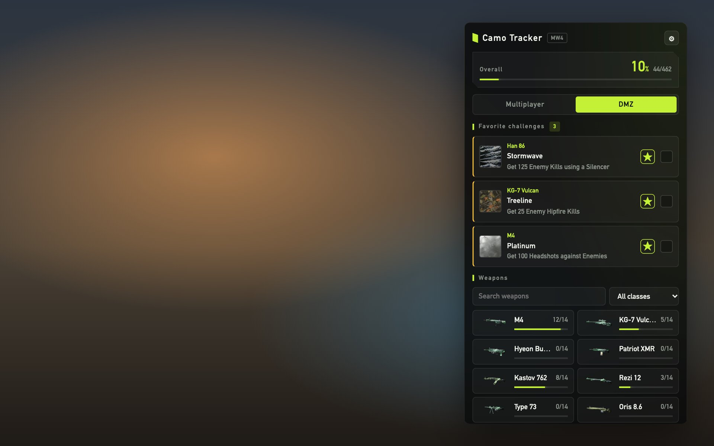
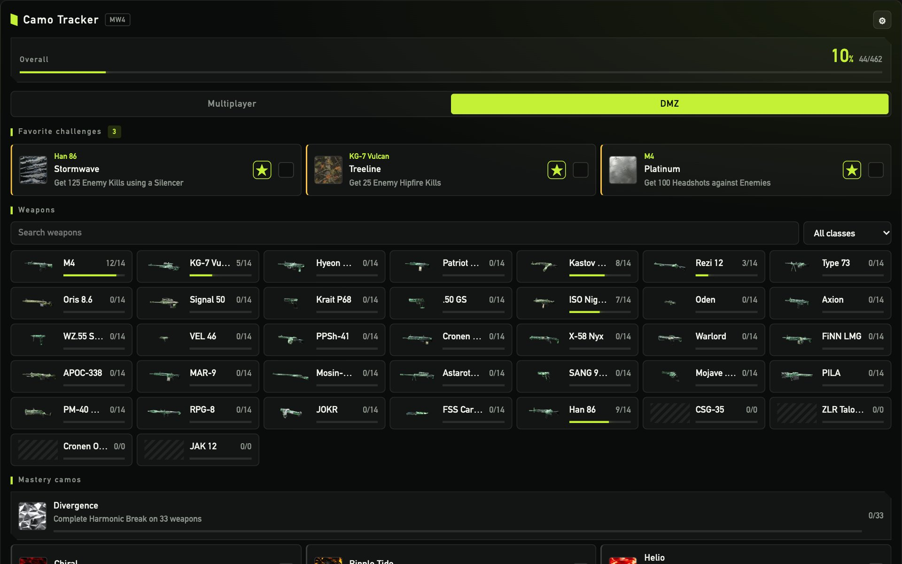
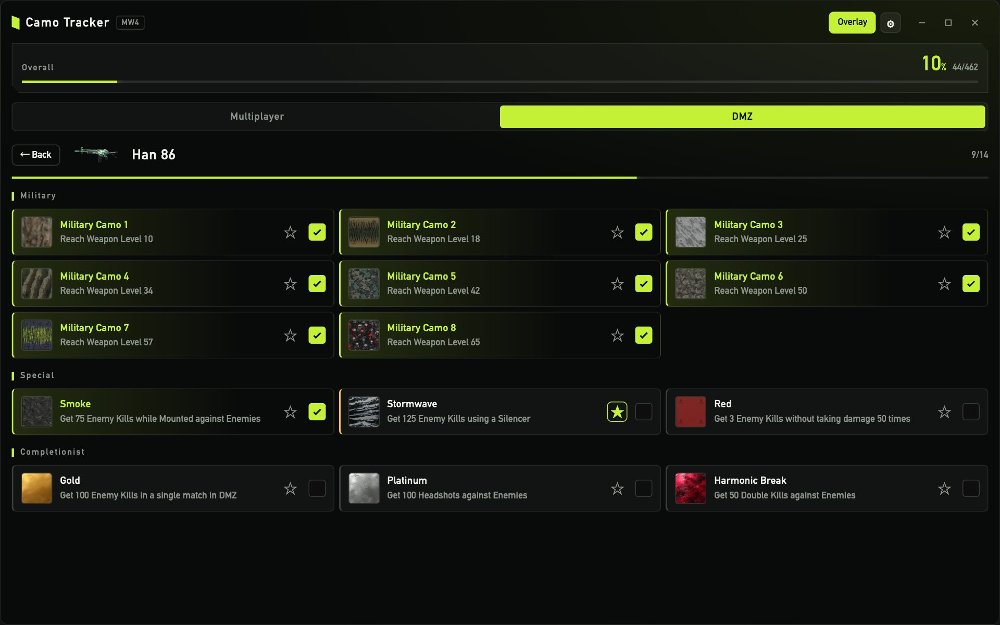
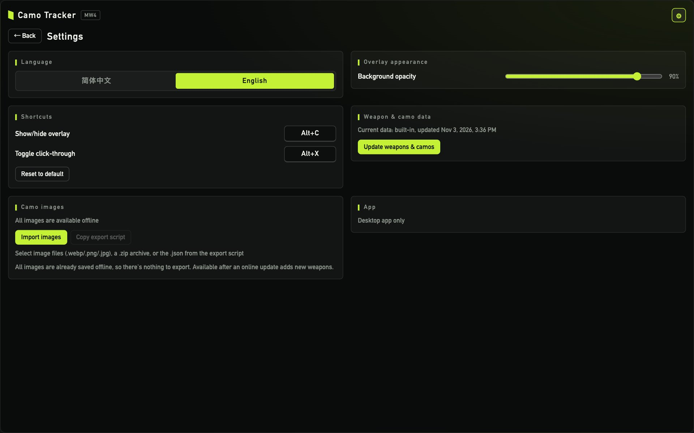

<div align="center">

# COD Camo Tracker

**An in-game camo progress overlay for Call of Duty: Modern Warfare 4 (Windows)**

[简体中文](README.md) · English

[](https://github.com/CodeWriter-Jay/cod-camo-tracker/releases/latest)
[](https://github.com/CodeWriter-Jay/cod-camo-tracker/stargazers)


⭐ If this saves you a few alt-tabs on the way to Gold, please consider giving it a **Star**. It really keeps the updates coming!

</div>



<p align="center"><sub>The overlay sits on top of the game as a translucent, always-on-top window, with adjustable background opacity and size</sub></p>

## Features

- **In-game overlay**: a transparent, always-on-top window. `Alt+C` shows or hides it and `Alt+X` toggles click-through, so you never have to leave the game to check progress
- **Adjustable look**: set background opacity from 30% to 100%; drag the bottom-right corner to resize, and size and position are remembered
- **Favorite challenges**: pin the camos you're grinding to the home screen; once checked off, each is replaced by that weapon's next camo
- **Mode-aware requirements**: Multiplayer and DMZ share completion, and switching modes shows each mode's own challenge
- **Prerequisite auto-check**: checking a military camo fills in the earlier military camos; checking Gold (or any completionist camo) fills in every earlier camo on that weapon
- **English & Chinese**: UI, weapon names and challenge text in English or Simplified Chinese
- **Works offline**: data plus 150 camo and weapon images ship with the installer
- **Online data updates**: when new weapons drop, pull the latest weapons and camos from codmunity in one click
- **Auto-update**: check for a new version in Settings and install it in place



<table>
  <tr>
    <td width="50%"></td>
    <td width="50%"></td>
  </tr>
  <tr>
    <td align="center">Weapon details: Military / Special / Completionist groups, ☆ to favorite, check when done</td>
    <td align="center">Settings: language, appearance, shortcuts, data update, image import, app updates</td>
  </tr>
</table>

## Install

1. Open [Releases](https://github.com/CodeWriter-Jay/cod-camo-tracker/releases/latest) and download `COD.Camo.Tracker_x.y.z_x64-setup.exe`
2. Run the installer. Images and data are bundled, so no internet connection is needed to use it
   (if the WebView2 runtime is missing it is downloaded during install; Windows 10/11 usually ships with it)
3. Future versions can be installed from **Settings → Check for updates**

## Usage

| Action | What it does |
|---|---|
| `Alt+C` | Show / hide the overlay |
| `Alt+X` | Toggle click-through: mouse input goes to the game and the overlay shows only your favorite challenges |
| ☆ | Favorite a camo in weapon details; favorites appear at the top of the home screen |
| Checkbox | Mark a camo as done; unchecking only affects that camo |
| Bottom-right corner | Drag to resize the overlay; drag the title bar to move it |

- Shortcuts and background opacity can be changed in Settings
- Run the game in **borderless windowed** or windowed mode; the overlay can't draw over exclusive fullscreen
- The tracker is just a separate always-on-top window. It **does not inject into the game or read game memory**

## Development

```bash
pnpm install
pnpm dev          # browser preview (no Tauri runtime, progress stored in localStorage)
pnpm tauri dev    # desktop app, requires the Rust toolchain
pnpm test && pnpm lint && pnpm typecheck
```

Stack: Tauri 2 · React 19 · TypeScript · Vite · zod · Vitest. The Windows installer is built with `pnpm tauri build` on Windows (or by `tauri-action` on GitHub Actions).

### Releasing

Push a version tag and GitHub Actions builds the Windows installer and publishes it to Releases:

```bash
git tag v1.0.0 && git push origin v1.0.0
```

Bump the version in `package.json`, `src-tauri/tauri.conf.json` and `src-tauri/Cargo.toml` first.
CI signs the update bundle with the `TAURI_SIGNING_PRIVATE_KEY` / `TAURI_SIGNING_PRIVATE_KEY_PASSWORD` repository secrets
and uploads `latest.json`, which installed clients use to check for updates. If the private key is lost, installed clients
can no longer be updated, so keep a backup.

### Data

`src/data/mw4.json` (the built-in data) is generated. Don't edit it by hand:

```bash
pnpm data:build
```

- Source: `data-source/codmunity-mw4-raw.json`, a snapshot of the public [codmunity.gg](https://codmunity.gg/camo-tracker/mw4)
  endpoint `/api/public/camo-tracker/mw4` (exported from the page in a browser). Chinese weapon names come from codmunity's
  translations and live in `data-source/codmunity-zh-weapon-names.json`
- The transform and translation logic in `src/data/codmunity.ts` and `src/data/translate.ts` is shared by the build script and the
  in-app "Update weapons & camos" button. Untranslated challenge text fails the build; online updates fall back to English
- Camo and weapon images are bundled in `public/images/`; see the header of `scripts/sync-images.py` for how to refresh them.
  A unit test checks that every image referenced by the built-in data is bundled. Images for weapons added through online updates
  load from the CDN when online, or can be imported in Settings for offline use

## Support

If this project helps you:

- Give it a ⭐ **Star** so more camo grinders can find it
- Report bugs or request features in [Issues](https://github.com/CodeWriter-Jay/cod-camo-tracker/issues)
- Share it with your squad

## Disclaimer

This is an unofficial personal project and is not affiliated with Activision, Call of Duty or CODMunity.
Game names, camo and weapon images belong to their respective owners; data and images come from [CODMunity](https://codmunity.gg).
