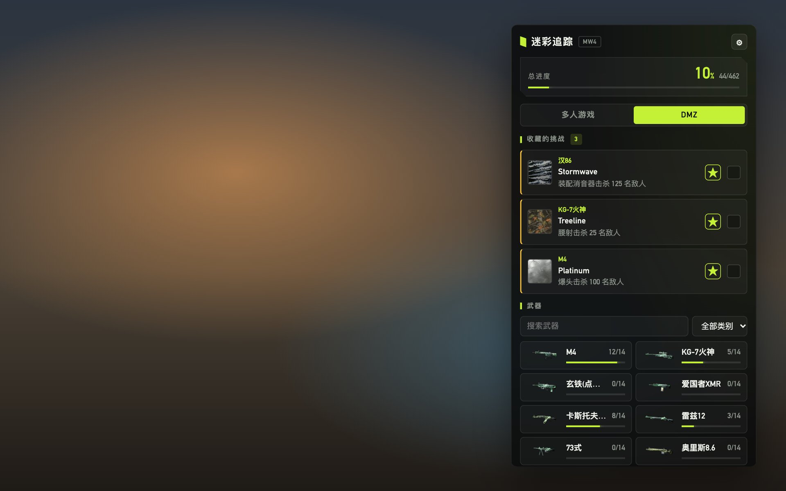
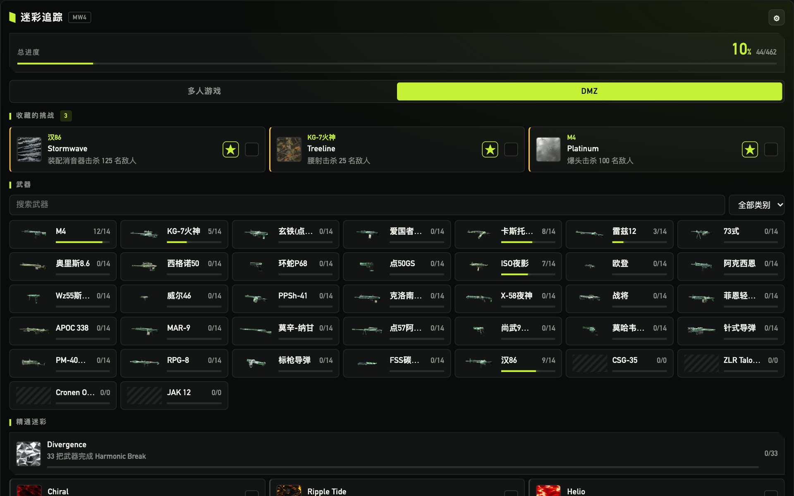
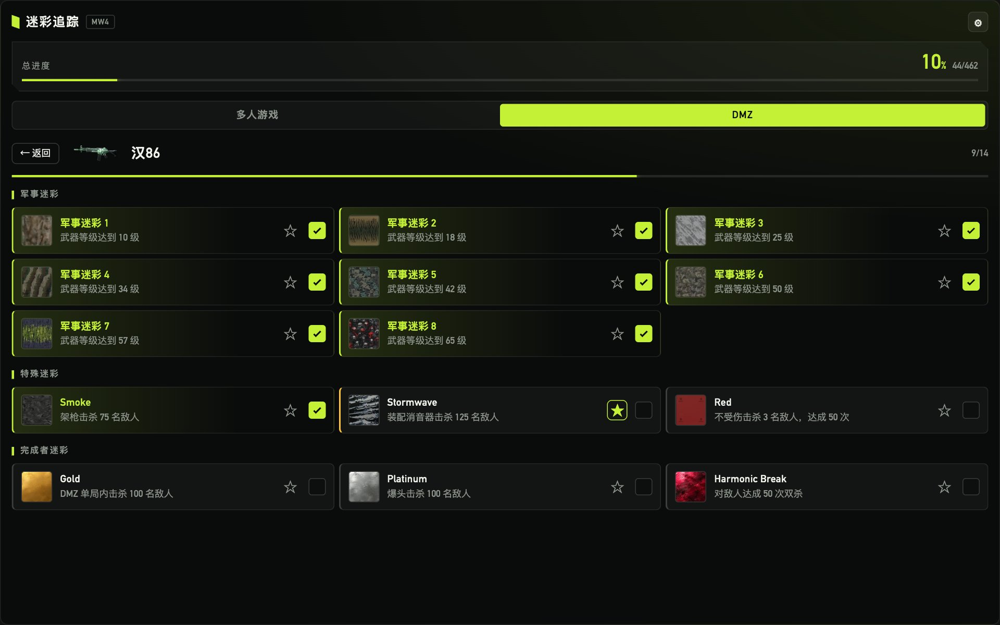
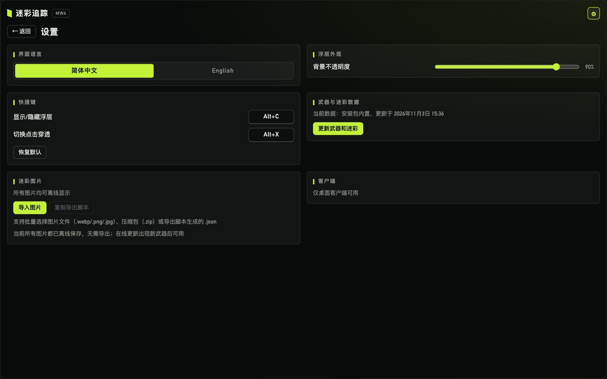

<div align="center">

# COD Camo Tracker

**Call of Duty: Modern Warfare 4 迷彩进度追踪浮层（Windows）**

简体中文 · [English](README.en.md)

[](https://github.com/CodeWriter-Jay/cod-camo-tracker/releases/latest)
[](https://github.com/CodeWriter-Jay/cod-camo-tracker/stargazers)


⭐ 如果这个工具帮你少切了几次屏、早一点拿到金皮，欢迎点个 **Star** 支持一下，这是我持续更新的最大动力！

</div>



<p align="center"><sub>浮层以半透明置顶窗口显示在游戏画面上，背景透明度与窗口大小均可调节</sub></p>

## 功能

- **游戏内浮层**：透明置顶窗口，`Alt+C` 呼出 / 隐藏，`Alt+X` 切换点击穿透，打游戏时不用切屏查进度
- **外观可调**：背景不透明度 30%–100% 可调；拖动右下角调整窗口大小，大小与位置自动记住
- **收藏挑战**：把正在刷的迷彩收藏到首页；勾选完成后自动切换到该武器的下一个迷彩
- **按模式显示要求**：多人游戏与 DMZ 共享完成状态，切换模式即可看到对应模式的挑战要求
- **前置迷彩联动**：勾选军事迷彩会补齐之前的军事迷彩，勾选黄金等完成者迷彩会补齐该武器之前的全部迷彩
- **中英双语**：界面、武器名与挑战描述均支持简体中文 / English
- **离线可用**：数据与 150 张迷彩、武器图片随安装包内置，无需联网
- **在线更新数据**：新武器上线后，在设置中一键从 codmunity 拉取最新的武器与迷彩
- **自动升级**：设置中检查更新，有新版本可直接下载安装



<table>
  <tr>
    <td width="50%"></td>
    <td width="50%"></td>
  </tr>
  <tr>
    <td align="center">武器详情：按军事 / 特殊 / 完成者分组，☆ 收藏、勾选完成</td>
    <td align="center">设置：语言、外观、快捷键、数据更新、图片导入、检查更新</td>
  </tr>
</table>

## 下载安装

1. 打开 [Releases](https://github.com/CodeWriter-Jay/cod-camo-tracker/releases/latest)，下载 `COD.Camo.Tracker_x.y.z_x64-setup.exe`
2. 运行安装程序即可。图片与数据均已内置，使用时无需联网
   （若系统缺少 WebView2 运行时，安装时会自动下载；Windows 10/11 通常已自带）
3. 之后的新版本可在客户端「设置 → 检查更新」中直接升级

## 使用说明

| 操作 | 说明 |
|---|---|
| `Alt+C` | 显示 / 隐藏浮层 |
| `Alt+X` | 切换点击穿透：开启后鼠标操作穿透到游戏，浮层只显示「收藏的挑战」 |
| ☆ | 在武器详情中收藏迷彩，收藏的迷彩显示在首页最上方 |
| 勾选框 | 标记迷彩完成；取消勾选只影响该迷彩本身 |
| 右下角拖动 | 调整浮层窗口大小；拖动顶部标题栏移动位置 |

- 快捷键与背景不透明度可在设置中修改
- 游戏需使用 **无边框窗口化** 或窗口化，独占全屏下浮层无法覆盖在游戏画面上
- 本工具只是一个独立的置顶窗口，**不注入游戏进程、不读取游戏内存**

## 开发

```bash
pnpm install
pnpm dev          # 浏览器预览（无 Tauri 运行时，进度存 localStorage）
pnpm tauri dev    # 桌面应用，需要 Rust 工具链
pnpm test && pnpm lint && pnpm typecheck
```

技术栈：Tauri 2 · React 19 · TypeScript · Vite · zod · Vitest。Windows 安装包需在 Windows（或 GitHub Actions 的 `tauri-action`）上执行 `pnpm tauri build`。

### 发布

推送版本标签即可由 GitHub Actions 构建 Windows 安装包并发布到 Releases：

```bash
git tag v1.0.0 && git push origin v1.0.0
```

发版前先同步修改 `package.json`、`src-tauri/tauri.conf.json` 与 `src-tauri/Cargo.toml` 中的版本号。
CI 会用仓库 Secrets 中的 `TAURI_SIGNING_PRIVATE_KEY` / `TAURI_SIGNING_PRIVATE_KEY_PASSWORD`
为升级包签名并上传 `latest.json`，已安装的客户端据此检查更新。私钥丢失将无法再给已安装的客户端推送升级，请妥善备份。

### 数据

`src/data/mw4.json`（安装包内置数据）由脚本生成，不要手改：

```bash
pnpm data:build
```

- 数据源：`data-source/codmunity-mw4-raw.json`，是 [codmunity.gg](https://codmunity.gg/zh/camo-tracker/mw4) 公开接口
  `/api/public/camo-tracker/mw4` 的快照（需在浏览器中打开该页面后导出）；武器中文名来自 codmunity 的翻译，
  维护在 `data-source/codmunity-zh-weapon-names.json`
- 转换与翻译逻辑在 `src/data/codmunity.ts`、`src/data/translate.ts`，内置数据生成与客户端「更新武器和迷彩」共用。
  生成内置数据时遇到未翻译的挑战描述会报错；在线更新时则回退显示英文
- 迷彩与武器图片打包在 `public/images/`，更新方式见 `scripts/sync-images.py` 顶部说明；单测会校验内置数据引用的图片均已打包。
  在线更新新增的图片联网时直接加载 CDN，也可在客户端设置中导入以离线使用

## 支持一下

如果这个项目对你有帮助：

- 点一个 ⭐ **Star**，让更多刷迷彩的朋友看到它
- 遇到问题或有想要的功能，欢迎提 [Issue](https://github.com/CodeWriter-Jay/cod-camo-tracker/issues)
- 分享给一起开黑的队友

## 声明

本项目为非官方的个人工具，与 Activision、Call of Duty 及 CODMunity 无关。
游戏名称、迷彩与武器图片的版权归各自权利人所有，数据与图片来自 [CODMunity](https://codmunity.gg)。
